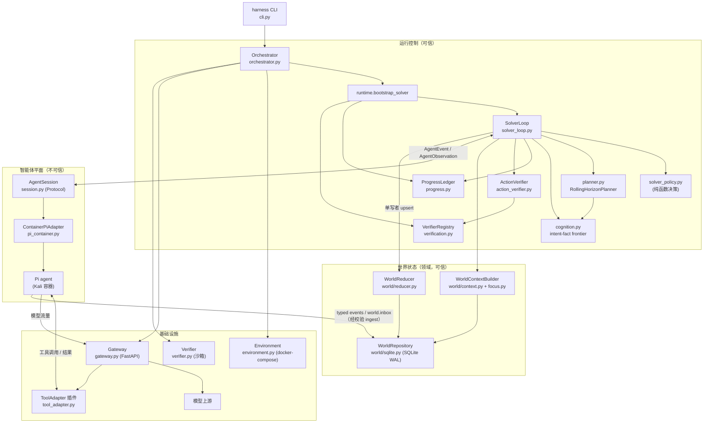
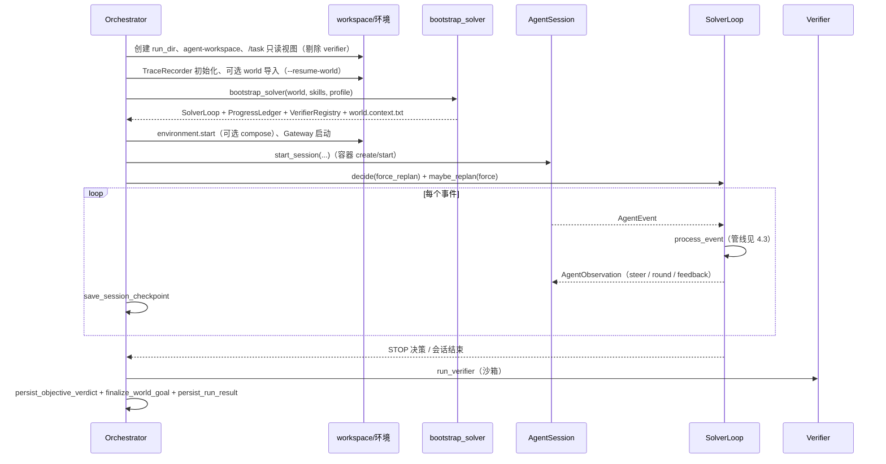
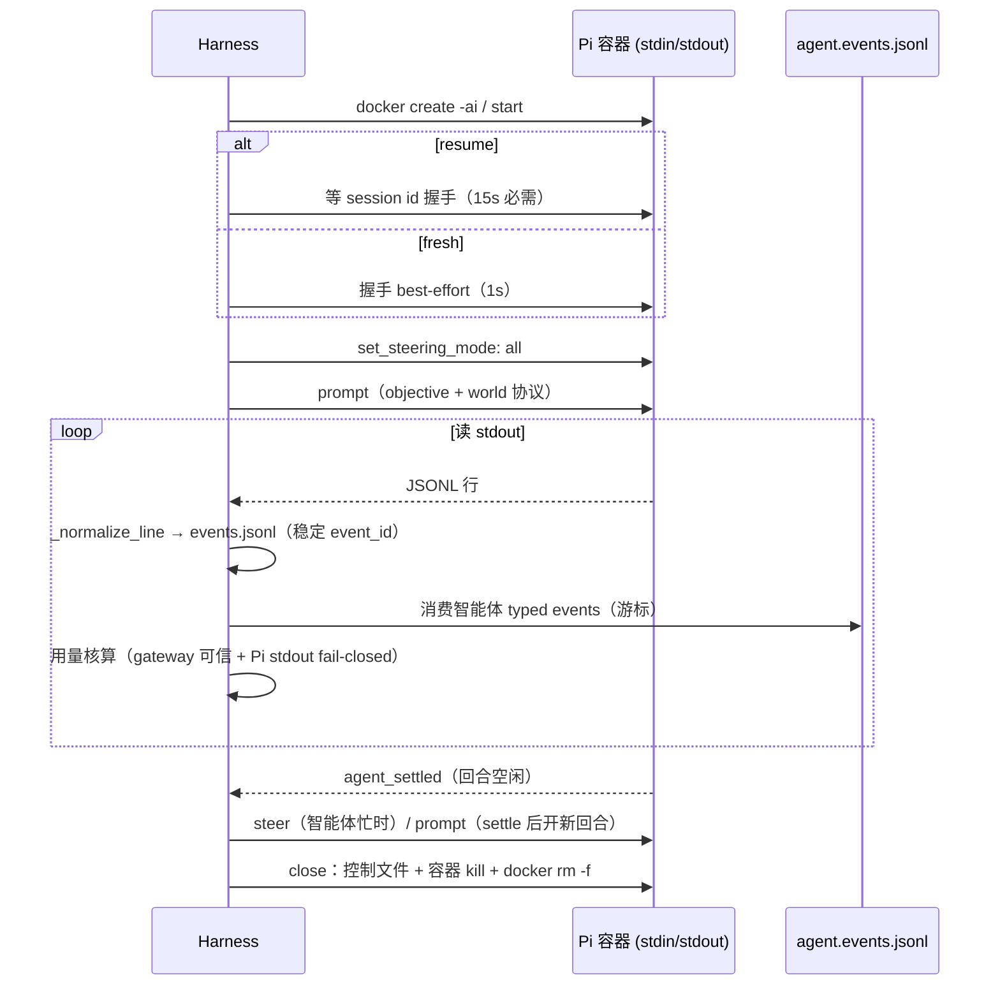
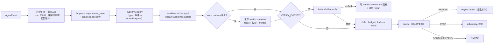
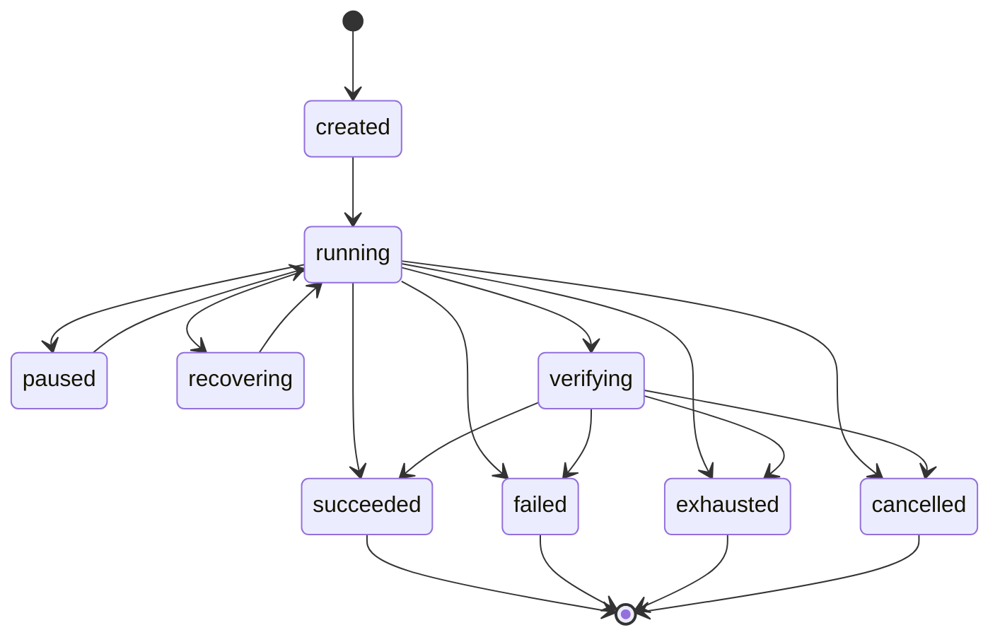

# 智能体架构设计（Agent Architecture）

> 基线：本文以当前工作树状态为准（commit `b17445f`「close the RPC loop, add round-based
> execution and tool-output facts」及其后的未提交重构）。
>
> 标注约定：陈述当前实现的事实标【现状】；本文提出的演进设计标【设计】；既定约束下的
> 取舍标【决策】。技术标识符保留英文原文，术语表见附录 D。图示使用 Mermaid。

## 1. 概述与目标

### 1.1 定位

red-harness 是一个可复现的安全智能体评测运行时：以受控闭环运行自治智能体（当前为
Kali 容器内的 Pi coding agent 1.0.4），完成基准任务（本地 Docker Compose 任务与 TSec
基准），并产出可审计的客观判定。本文覆盖**智能体侧架构整体**：适配层与会话契约、求解
控制闭环、世界状态、验证信任层级、预算、隔离与恢复。

核心分工（源自 [AGENTS.md](../AGENTS.md) 与 [README](../README.md)）：

- **Pi 拥有推理循环，Harness 拥有运行控制**。Harness 设定目标、约束与停止条件，从不
  代行智能体的逐步推理。
- 领域状态在 World（`world/`）；临时控制状态在 Runtime（`runtime/`）；客观判定在
  Verification（`verification.py`、`action_verifier.py`、`verifier.py`）。

### 1.2 设计目标

【现状】

1. **闭环控制主脊**：整个系统构成单一闭环反馈回路（参考 [control-theory.md](control-theory.md)），
   只有传感器（verifier / evaluator）可以闭合回路；其余一切皆为插件点。
2. **可恢复**：run 可从 crash 中恢复（checkpoint + 动作对账），恢复不得重放副作用不明
   的动作。
3. **证据驱动**：所有判定由带证据的权威裁决支撑；智能体自述只是 claim。
4. **离线可测**：核心逻辑不依赖网络安装与外部服务；网络出口按 profile 显式约束。
5. **有界自治**：no-progress 停机、replan 上限、预算底线等硬安全界由纯函数策略
   （`solver_policy.py`）执行。

### 1.3 非目标

【现状】（工程规则，见 AGENTS.md）

- 微服务、强制 DAG、神经世界模型、向量数据库。
- 给 TSec 基准核心侧特殊地位（TSec 集成限于 benchmark 适配器）。
- Harness 侧 chain-of-thought：Harness 不生成推理文本，只做类型化状态与控制。

【决策】

- **多智能体（roadmap PLN-04）明确列为非目标**：单 run 单智能体。租约式共享工作、
  子智能体、团队协作不在本架构范围内；除非未来消融证据显示并行收益显著并经维护者
  重新评审（见 9.4）。

### 1.4 与既有文档的分工

| 文档 | 覆盖范围 | 与本文关系 |
| --- | --- | --- |
| [architecture.md](architecture.md) | 模块边界、import 规则、架构测试 | 本文引用其边界规则，不重复 |
| [control-theory.md](control-theory.md) | 控制论闭环建模与剪枝依据 | 本文是其智能体侧的具体化 |
| [agent-engineering.md](agent-engineering.md) | 认知层 / intent–fact frontier 算法 | 本文引用，不重复算法细节 |
| [world-state.md](world-state.md) | 世界模型设计与扩展指南 | 本文只引用契约层 |
| [pi.md](pi.md) | Pi 集成操作细节 | 本文引用 |
| [security/execution-boundary.md](security/execution-boundary.md)、[security/gateway-tools.md](security/gateway-tools.md) | 威胁模型 | 本文第 6 章做不变量汇总 |
| [roadmap/](roadmap/) | 交付状态（source of truth） | 本文第 9 章只做架构视角串联 |

## 2. 架构总览

### 2.1 组件图

【现状】



关键要点：

- **单写者原则**：World 只由 Harness 写入（`WorldReducer` 强制信任降级）；智能体经
  typed events（`$HARNESS_EVENT_FILE`）与 `world.inbox.jsonl` 提交，一律按不可信输入
  校验。
- **Gateway 是唯一的工具与模型出口**：`/v1/tools/call` 走 allowlist 与路径 jail，
  `/v1/chat/completions` 代理模型流量并做可信用量核算。
- **Verifier 独立于智能体**：目标判定（objective verdict）由沙箱化 verifier 产生，
  智能体自述永远不能自证。

### 2.2 模块清单与职责

【现状】（详见 [architecture.md](architecture.md)，此处为智能体视角摘要）

| 层 | 模块 | 职责 |
| --- | --- | --- |
| 入口 | `cli.py`、`orchestrator.py` | run 生命周期、环境集成、恢复 |
| 会话 | `agent.py`、`session.py`、`pi_adapter.py`、`pi_container.py` | 适配器、会话协议、Pi 事件规范化、RPC 会话 |
| 求解策略 | `solver_loop.py`、`solver_policy.py`、`planner.py`、`cognition.py`、`action_verifier.py` | 事件管线、纯函数决策、规划、frontier、动作验证 |
| 领域状态 | `world/`（models、reducer、sqlite、context、focus、live、protocol） | 事件溯源、投影、有界上下文、不可信 ingest |
| 运行时 | `runtime/`（bootstrap、lifecycle、checkpoint、projections、results、evidence、solver_profile） | 组合点、相位机、checkpoint、结果持久化 |
| 基础设施 | `gateway.py`、`gateway_runtime.py`、`tool_adapter.py`、`network_policy.py`、`environment.py`、`verifier.py` | 工具/模型代理、网络策略、目标验证 |
| 基准 | `benchmark/`（base、runner、tsec_adapter、zc_adapter） | 外部任务 provision/提交/仲裁 |

### 2.3 依赖方向与强制项

【现状】`tests/test_architecture.py` 以 AST 解析强制：

- `world/`、`runtime/` 不得 import FastAPI / Starlette / Docker / subprocess / httpx /
  TSec SDK；benchmark 适配器不得 import CLI / gateway / web server 实现。
- **控制主脊 import 闭包冻结**（`runtime.bootstrap`、`benchmark.runner`、
  `solver_loop` 的 import 闭包限定在声明集合内），被删除的开环子系统（控制面 API、
  worker 队列、协调黑板）不得悄悄回归。

## 3. 核心抽象与契约

### 3.1 AgentSpec / PiSpec

【现状】`src/harness/models.py`

- `AgentSpec`：`id`、`type: cli | docker | pi`、`command`、`env`、`image`、
  `network: environment | none | host`、`network_profile`（6 档）、`runtime`
  （可选 gVisor runsc）、`pi: PiSpec | None`。校验器强制：pi 类型必须有 `image`；
  容器智能体的 env 禁止携带保留凭据变量（`_is_reserved_credential_env`）。
- `PiSpec`：`binary`、`mode: rpc | json`、`provider/model/thinking`、`tools`
  （默认 `read/bash/edit/write`）、`--no-skills` 等能力关闭旗标、`offline`、
  `system_prompt_file`、`env_passthrough`、`cap_add`、`extra_args`。

### 3.2 适配器层

【现状】`src/harness/agent.py`

`build_agent_adapter(spec, allow_host_agent=, trace=)` 按类型分发：

| 适配器 | 类型 | 语义 |
| --- | --- | --- |
| `CLIAdapter` | `cli` | 宿主机进程，开发路径，必须显式 `--allow-host-agent` |
| `DockerAdapter` | `docker` | 一次性容器，`build_container_command` 单一硬化 docker create |
| `ContainerPiAdapter` | `pi` | rpc 模式 → `start_session()`（交互会话）；json 模式 → `run()`（一次性） |

`AgentResult{returncode, timed_out, budget_exceeded, stdout, stderr, metrics}` 为统一
结果。容器硬化默认值：`--read-only`、`--cap-drop ALL`、`no-new-privileges`、
pids/memory/cpus/tmpfs 限制、非 root UID/GID、`--pull=never`。

### 3.3 AgentSession 协议

【现状】`src/harness/session.py`

```python
class AgentSession(Protocol):
    async def events(self) -> AsyncIterator[AgentEvent]: ...
    async def observe(self, observation: AgentObservation) -> None: ...
    async def checkpoint(self) -> AgentCheckpoint: ...
    async def close(self, reason: str) -> None: ...
    async def result(self) -> AgentResult: ...
```

- `AgentEvent{type, data, event_id?}`：规范化后的智能体→Harness 事件。
- `AgentObservation{type, data}`：Harness→智能体反馈。
- `AgentCheckpoint{id, event_offset, feedback_offset, session_id?, gateway_event_offset}`：
  会话游标。
- `OneShotAgentSession`：兼容实现，用文件游标 tail `events.jsonl` 包裹遗留
  `adapter.run()`；`observe()` 只落盘 `agent.feedback.jsonl`（无实时引导）。
- `ContainerPiRpcSession`（`pi_container.py`）：RPC 交互实现，是当前主路径。

### 3.4 HARNESS_* 环境契约

【现状】`agent.py::task_environment` 注入 14 个变量（完整表见附录 A）：任务与 run
路径、`HARNESS_EVENT_FILE` / `HARNESS_WORLD_INBOX` / `HARNESS_WORLD_CONTEXT` /
`HARNESS_SUBMISSION_INBOX` / `HARNESS_FEEDBACK_FILE` / `HARNESS_SUMMARY_FILE` /
`HARNESS_PROGRESS_FILE`、`HARNESS_NETWORK_PROFILE`、`HARNESS_SEED`。RPC 模式下智能体
的 typed events 写独立的 `agent.events.jsonl`（RPC 会话独占 stdout，见 `agent.py` 顶部
注释）。

### 3.5 规范化事件流

【现状】`pi_adapter.py::_normalize_line` 把 Pi JSONL 映射为 harness 规范事件：

| Pi 事件 | 规范事件 | 关键字段 |
| --- | --- | --- |
| `session` | `pi.session` | session_id、version |
| `agent_settled` | `pi.agent_settled` | — |
| `tool_execution_start` | `tool.call` | `tool_call_id`、`args_fingerprint`（sha256 截断）、`args_family`（如 `bash:curl`） |
| `tool_execution_end` | `tool.result` | `exit_code`、`duration_ms`、`is_error`、`output_excerpt`（8 KiB 有界消毒摘录） |
| `message_start/end` | `model.request` / `model.response` / `model.usage` | usage 核算 |

`args_family`（`_command_family`）给出 shell 命令的粗粒度恒等，使「同一攻击线反复
研磨」可被识别；`output_excerpt` 经 `sanitize_observability_data` 消毒后才进入工件。

### 3.6 Typed ACI 事件

【现状】`aci.py::TypedACI.apply` 是类型化智能体事件的唯一翻译点：

- `action.intent` → `ActionIntent{action_id, subgoal_id?, skill_id?, tool?,
  expected_observations, success_conditions, replan_conditions}` 进 ProgressLedger。
- `world.observe / hypothesis / capability / artifact / failure` → 校验后 upsert 进
  World（actor=`agent:<id>`，信任上限 claim）。
- `tool.call` → `ActionRecord(status=running)`；`tool.result` →
  `ActionRecord(succeeded|failed)` + `obs:tool:<call_id>` 记账观察（evidence 层）+
  `extract.py::extract_facts` 从 `output_excerpt` 提取证据层事实（nmap/gobuster/ffuf，
  内容寻址 id `extract:<sha256[:16]>`，单事件上限 `MAX_EXTRACTED_FACTS=25`）。
- 校验失败 → `aci.feedback{accepted: false}` 反馈给智能体（fail-closed，不中断 run）。

### 3.7 求解器契约

【现状】

- `SolverAction = CONTINUE | VERIFY | REPLAN | STOP`，`SolverDecision{action, reason}`；
  `solver_policy.py::decide_solver_action` 是无副作用的纯函数，硬安全界：no-progress
  停机（默认 6）、unconfirmed-progress 停机（默认 40）、replan 上限（默认 8）、预算耗尽、
  低预算（≤5%）且无进展即停。
- `Planner` 协议 → `RollingHorizonPlanner`（horizon ≤ 3）包裹 `GoalFrontierPlanner`
  （默认）或 `HeuristicSkillPlanner`（加权评分：novelty/goal/focus/friction/budget）。
- `SkillSpec`（`harness/skill/v1`）：声明式 `requires/produces` StateSelector +
  cost/risk/noise 元数据，**不可执行**。
- 求解剖面（`runtime/solver_profile.py`）：`pi-only` / `pi-world` /
  `pi-world-heuristic` / `pi-world-goal`（默认），构成 Agent×World×规划的实验矩阵。

### 3.8 World 契约

【现状】`world/models.py`、`world/protocol.py`

- `WorldEvent{schema_version: harness/world/v1, kind, op: upsert|remove, object, actor,
  source_event_id}` 事件溯源；`WorldSnapshot(revision)` 为物化投影。
- 10 种记录类型：Entity / Relation / Observation / Artifact / Capability / Hypothesis /
  Goal / ActionRecord / Constraint / Failure，共同基类 `WorldRecord`（provenance、
  temporal validity `valid_from/expires_at`、`supersedes/contradicts` 链接）。
- `StateSelector{kind, type, scope?, minimum_trust}`：技能前置/产出与目标状态共享的
  声明式词汇。
- 信任层级 `TRUST_RANK：unclassified=claim=1 < evidence=2 < verified=3`。
- `WorldSubmission`（`world/protocol.py`）：不可信 ingest 的校验契约。

### 3.9 Gateway 契约

【现状】`gateway.py`（FastAPI，per-run）

- `POST /v1/tools/call`：policy allowlist 之内的工具代理；`tool_call_id` 唯一性以
  409 拒绝重复；文件访问经 `secureio.open_beneath` 路径 jail；`ToolAdapter` 插件
  （如 `SandboxedProcessToolAdapter`、`AuthorizedHTTPToolAdapter`）产出 sha256
  `evidence_refs`。
- `POST /v1/chat/completions`：OpenAI 兼容模型代理，流式用量核算写入**可信**
  `gateway.events.jsonl`（位于 run 目录之外，即智能体不可写路径，
  `gateway_runtime.py`）。
- 两种运行时：`HostGatewayRuntime` / `DockerGatewaySidecarRuntime`（隔离 sidecar 容器）。

### 3.10 契约演进

【设计】（2026-10-14 已实施，见 9.2）当前适配器 `run()/start_session()` 传递 12+ 个散
kwargs（task、task_dir、agent_task_dir、run_dir、environment_*、seed、gateway_*、
cancel_path 等），在四个适配器类间复制且无共享类型。演进方向：

1. **`AgentRunContext`**：冻结 dataclass 收敛全部会话启动参数，适配器签名变为
   `start_session(ctx)`；一处加字段，四处不再漂移。
2. **事件 schema 化**：`AgentEvent.data: dict[str, Any]` 按 event type 子类型化为
   pydantic 模型，使 `TypedACI` 的 ad-hoc 校验移到边界处（与 8.4 联动）。
3. **`AgentCapabilities`**：适配器声明能力（支持 steer？支持哪些 typed events？提交
   走哪条通道？），bootstrap 时协商并在 trace 记录降级决策；把「one-shot 反馈只是
   尽力而为的文件」从隐含事实变成显式契约。

## 4. 数据流与时序

### 4.1 本地 run 主时序

【现状】`orchestrator.py::_run`



### 4.2 RPC 会话往返

【现状】`pi_container.py::ContainerPiRpcSession`



要点：`observe()` 只对 9 类 `_STEER_TYPES` 观察做实时注入（`solver.verification` /
`solver.plan.updated` / `solver.replan_requested` / `aci.feedback` /
`benchmark.feedback` / `world.state.updated` / `solver.budget` / `solver.finalize` /
`solver.round`），其余仅落 `agent.feedback.jsonl`。

### 4.3 事件处理管线

【现状】`solver_loop.py::SolverLoop.process_event`



### 4.4 反馈回路与用量核算

【现状】

- 反馈通道：`observe()` → `agent.feedback.jsonl` 落盘 + RPC 实时注入；智能体可读
  `world.context.txt`、`progress.json`、`round-N.md`、`agent.feedback.jsonl`。
- 用量计费双路径：Gateway 模式 = 可信 `gateway.events.jsonl`（run 目录外）+ 字节游标
  断点续传；直连模式 = Pi stdout usage 事件（不可信，但 fail-closed 校验：负数/布尔/
  畸形/缺失即 `invalid_telemetry` 终止，已计费用量保留）。

### 4.5 benchmark 路径差异

【现状】`benchmark/runner.py` 相对本地 run 的差异：环境由 SDK provision/teardown；
提交走 `submission.inbox.jsonl` 交互式仲裁（非一次性最终判定）；`evaluate_final()`
独立产生 `ObjectiveVerdict`（producer=`benchmark_evaluator`）；反馈写成 World
observation 再 observe 给智能体。

## 5. 状态与生命周期

### 5.1 Run 相位机

【现状】`runtime/lifecycle.py::RunLifecycle`（纯状态机，9 相位）



`resolve_run_status` 优先级：objective_completed > timeout > budget_exceeded > finished
（外部评估的目标完成优先于智能体侧限制）。注意：`paused` / `recovering` 已定义转移
但当前无入口（见 5.6）。

### 5.2 会话生命周期（隐式）

【现状】RPC 会话状态是 `ContainerPiRpcSession` 的私有旗标（`_prompt_sent`、
`_settled`、`_closed`）：started → prompting → busy/settled 交替 → crashed
（`agent.session.crashed` 事件）或 closed。OneShot 会话只有 task-done 语义。

### 5.3 Round 生命周期

【现状】`solver_loop.py::_maybe_start_round`。Round = 同一会话上的一个新 `prompt`，
携带 `round_brief`（cognition.py 编译：已确立事实、agent 声称的线索、已排除路径、
开放 frontier、重复无收获的命令族、预算状态），落盘 `round-N.md`。

- 触发条件：事实/意图图 fingerprint 变化（新增 evidence/verified 事实、agent 新记录、
  或新排除的 intent）**或** 连续 `ROUND_STALL_STEPS=6` 个 tool.result 无新事实。
- fingerprint =（established facts ∪ agent-claimed records）×（ruled-out intents）；
  Harness 记账观察（`tool.execution`）排除在外，避免每步误判为图变化。
- brief 文本去重：未 stalled 且 brief 不变则不重复注入。

### 5.4 World 事件溯源

【现状】`WorldEvent` append-only → `WorldReducer.apply/replay` → `WorldSnapshot`；
reducer 同时执行信任降级策略（agent actor → claim；benchmark/verifier → evidence；
harness 可声明 evidence/verified；其他 unclassified）。`SQLiteWorldRepository`
（WAL、event_id 唯一幂等 append、乐观并发 `expected_revision`、`integrity_check`
重放校验）。`ActionRecord.status：planned/running/succeeded/failed/unknown`，
`unknown` 专供恢复期对账前的不确定动作。

### 5.5 Checkpoint / Resume

【现状】`runtime/checkpoint.py`

- `RunCheckpoint`（`harness/checkpoint/v2`）：会话 id、event/feedback/gateway 游标、
  processed_event_ids、预算已用量、计划 revision；每个事件后保存。
- Resume 仅支持 Pi RPC run，前置校验：task/agent 配置 sha256 一致、solver profile 一致、
  checkpoint 连贯、**无未对账的 reconciled 动作史**、容器不在运行。
- `run_action_owner`：flock 保证同一 run 目录只有一个操作者在做恢复/对账。

### 5.6 生命周期演进

【设计】（第 1 项已于 2026-10-14 实施为 `session.py::SessionPhaseTracker`，见 9.2）

1. 显式 `AgentSessionPhase` 状态机（started / prompting / steering / settled /
   crashed / closed / resumed），与 `RunLifecycle` 相位对齐并写入 trace；替换私有
   旗标。
2. `paused` / `recovering` 两相位：要么接入真实入口（对账期间进入 recovering），要么
   从 `RunPhase` 删除，避免「定义了但永不可达」的契约噪声。
3. Round 计数与摘要进入 `result.json` 与 checkpoint，使跨 run 的回合行为可比。

## 6. 信任边界与安全不变量

### 6.1 信任层级

【现状】`Provenance.epistemic_status` 与 `TRUST_RANK`：

```text
unclassified = claim (1)  <  evidence (2)  <  verified (3)
```

- 智能体 authored 记录（actor 前缀 `agent:` / `agent:<id>`）**永远 ≤ claim**，由
  reducer 强制，无法通过提交内容自抬。
- `tool.execution` 记账观察与 extract 提取的事实由 harness 写入，为 evidence 层。
- verified 只能来自权威裁决（见 6.2）。

### 6.2 四区分（claim ≠ exit ≠ effect ≠ goal）

【现状】AGENTS.md 规则落到类型系统：

| 概念 | 载体 | 谁能确认 |
| --- | --- | --- |
| 声明（claim） | agent typed events / world 提交 | —（上限 claim） |
| 工具退出（tool exit） | `tool.result` exit_code + `obs:tool:*`（evidence） | harness 记账 |
| 动作效果验证（action-effect） | `ActionVerdict`（`ActionVerifier`） | 仅 `VerifierRegistry` 授权的 capability |
| 目标完成（goal completion） | `ObjectiveVerdict` | 仅 `task_verifier` / `benchmark_evaluator`（必须带 `EvidenceRef`） |

`VerifierRegistry`（`verification.py`）用进程内 nonce+capability 对签发
`AuthorizedActionVerdict / AuthorizedObjectiveVerdict`，智能体侧不可伪造、不可跨进程
重放。

### 6.3 文件系统边界

【现状】run root 归 Harness 所有（world.db、trace、result、checkpoint、verifier
logs）；智能体只见只读 `/task` 快照（**剔除 verifier 入口**，symlink 安全，有界
4096 文件 / 2 GiB）与可写 `agent-workspace/`。`secureio` 不跟随符号链接并拒绝非常规
文件。可信 `gateway.events.jsonl` 位于 run 目录之外（智能体不可写路径）。

### 6.4 容器与网络

【现状】容器硬化默认值见 3.2；`cap_add` 为显式 opt-in 白名单（来自受信 AgentSpec
配置面）。网络 6 档 profile 强制拓扑（`network_policy.py`）：`offline` /
`fully-offline` → network none；`target-only` → 仅目标内网；`model-allowed` →
sidecar Gateway 内网；代理环境变量按 profile 拒绝注入。

### 6.5 凭据

【现状】benchmark 凭据与模型 API key 只在 Harness/Gateway 侧；Gateway token 单 run
一次性；保留名凭据 env 注入被校验器拒绝；trace 与异常文本统一
`sanitize_observability_data` 消毒（「details omitted」模式），凭据不进 trace/工件。

### 6.6 不变量清单

【现状】（编号供测试与评审引用；矩阵映射见【设计】）

| # | 不变量 |
| --- | --- |
| I1 | 不可信智能体输出不得成为 verified evidence（信任降级由 reducer 强制） |
| I2 | 智能体容器不得变更权威状态（World 单写者 + 文件边界） |
| I3 | 重试不得重复不安全副作用（tool_call_id 409 去重 + 动作对账先行） |
| I4 | 不得声明 exactly-once 执行（无原子协议支撑即不得声称） |
| I5 | 目标完成只能由授权 producer 带 evidence 判定 |
| I6 | 凭据不进 trace/工件（消毒边界） |
| I7 | 未知 in-flight 动作必须先对账再重试 |
| I8 | 遥测缺失/畸形 fail-closed（终止并保留已计费用量） |
| I9 | 核心逻辑离线可测、无 runtime 安装 |
| I10 | 基准不得泄漏进核心（TSec 限于 benchmark 适配器） |

【设计】把 I1–I10 与 `tests/test_architecture.py`、安全测试、`docs/security/*` 建立
显式映射矩阵（每条不变量至少一个测试锚点），在评审 trust-boundary 变更时按矩阵核对。

## 7. 错误处理与恢复

### 7.1 失败分类

【现状】run 级 `failure_class` 由 `run_phase` 推导：environment / gateway / solver /
harness_failure、solver_budget_exhaustion、verifier_unavailable、cancelled、success。

### 7.2 fail-closed 遥测

【现状】`budget.py` / `pi_container.py`：负数、布尔冒充数值、畸形、缺失 usage、文件
截断/替换/symlink、total≠in+out → `invalid_telemetry` 终止；终止前已确认的用量保留，
不多退少补。

### 7.3 动作对账

【现状】`runtime/checkpoint.py`：`reconcile_pending_actions` 在恢复前把 in-flight
动作归到确定状态；带 reconciled 历史的 run 拒绝 resume（宁可重跑，不冒重复副作用）；
`run_action_owner` flock 排他。预算在 resume 时重算剩余量。

### 7.4 软时限收敛协议

【现状】`solver_loop.py`：

```text
预算引导 steer（剩余 50% / 25% / 10% 各一次："收敛，勿开新探索"）
  → 软到期 solver.finalize steer（"停止新探测，写 agent.summary.md"）
  → settle 后摘要缺失 → 再 prompt 一次
  → FINALIZE_GRACE_SECONDS = 180s 宽限后 kill
```

### 7.5 取消与信号

【现状】SIGINT/SIGTERM → `RunInterrupted`（run 拥有的资源有序关闭）；会话关闭写
`agent.control.jsonl` 控制记录；容器 kill + `docker rm -f` 兜底；teardown 失败不掩盖
run 结果。

### 7.6 操作重试策略

【设计】harness 侧操作（docker create/start、gateway 重启、checkpoint 写失败）目前
ad-hoc 重试。建立显式重试策略表：每类操作的最大次数、退避、幂等键（如容器名 =
run id 派生、gateway token 单次性）与失败上浮路径；`ActionRecord.status=unknown` 的
对账语义文档化，与 I3/I7/I4 对齐。

## 8. 观测性与可审计性

### 8.1 产物清单

【现状】（同一 run 目录，写者与信任级各异；首次在此汇总）

| 产物 | 写者 | 信任级 |
| --- | --- | --- |
| `trace.jsonl` | Harness | 权威 |
| `events.jsonl` | 适配器（规范化智能体流） | 不可信来源、规范记录 |
| `agent.events.jsonl` | 智能体（RPC typed events） | 不可信 |
| `agent.feedback.jsonl` | Harness（反馈） | 权威 |
| `gateway.events.jsonl` | Gateway（run 目录外） | 可信计费 |
| `world.db` + `world.events.jsonl` + `world.snapshot.json` | World repository | 权威（事件溯源） |
| `progress.json` | SolverLoop | 权威（临时控制态） |
| `plan.json`、`round-N.md` | SolverLoop | 权威 |
| `agent.summary.md` | 智能体 | 不可信 |
| `result.json`（`harness/result/v2`，原子硬链接写） | runtime.results | 权威 |

### 8.2 事件分类

【现状】前缀即生产者：`agent.*` / `tool.*`（tool.call、tool.result）/ `model.*` /
`aci.*` / `world.*` / `solver.*`（decision、plan.updated、budget、finalize、round、
verification、stop）/ `benchmark.*` / `budget.*`（exceeded、ignored）/ `run.*` /
`gateway.*` / `pi.*`。逐事件的生产/消费位置目前散落各模块（速查表见附录 B）。

### 8.3 审计与 replay

【现状】`audit.py` + `harness audit-run`：按确定性 reduction 重放 run 工件；冲突
event_id、坏 checkpoint 必须暴露而非吞掉。

### 8.4 事件 schema 单一来源

【设计】事件 taxonomy 目前是隐式约定（字符串前缀 + dict payload）。演进：pydantic
化为单一 schema 模块（与 3.10 的 `AgentEvent` 子类型化联动），trace/audit/文档从同一
schema 生成，消除「文档说了、代码做了、trace 记了」三者漂移。
（2026-10-14：Agent-authored typed events 已 schema 化为
`agent_events.py::TYPED_EVENT_SCHEMAS`；`tool.*`/`model.*` 规范化流的 schema 化仍开放。）

## 9. 演进路线

> 状态与验收以 [roadmap/](roadmap/) 为 source of truth；本章只做架构视角串联与本文
> 新增提案。状态语法：`[x]` 完成、`[~]` 进行中、`[ ]` 待办。

### 9.1 进行中（既有 roadmap 条目）

【现状】

- EXE-02 `[~]`：adapter/session 契约与资源核算收尾（真实 Docker Pi/Gateway smoke）。
- EXE-03 `[~]`：离线 profile 与确定性构建（clean-runner 复现）。
- RUN-02 `[~]`：crash-safe checkpoint 与动作对账（Docker CI 故障矩阵）。
- RUN-04 `[~]`：资源所有权（单一 teardown owner）。
- PLN-02 `[~]`：planner 消融与安全回退。
- PLN-05 `[~]`：goal-driven frontier（`pi-world-goal` 已默认，live 消融待做）。
- PLN-06 `[~]`：round-based execution（本基线已闭环；follow-up：agent claims 计入
  图变化的路径文档化、`extract.py` 支持更多工具输出格式）。

### 9.2 近期设计（本文提案，需开 roadmap 条目）

【设计】按性价比排序。**2026-10-14 更新：以下五项已在本工作树实施**，状态与证据见
roadmap EXE-05 / EXE-06 / WLD-05：

1. `AgentRunContext` 契约对象（3.10.1）——纯重构，消除四处 kwargs 复制。
   【已实施：`agent.py::AgentRunContext`，四个适配器与两个组合点均已切换】
2. `AgentSessionPhase` 显式状态机（5.6.1）——可观测性与恢复推理的基础。
   【已实施：`session.py::SessionPhaseTracker`，转换写入 trace 的
   `agent.session.phase` 事件】
3. 事件 schema 单一来源（8.4 + 3.10.2）——文档/trace/校验对齐。
   【已实施：`agent_events.py::TYPED_EVENT_SCHEMAS`，`TypedACI` 边界校验】
4. `AgentCapabilities` 协商（3.10.3）——把降级行为变成显式契约。
   【已实施：`session.py::AgentCapabilities`，run 入口发射 `agent.capabilities`】
5. 上下文组装 token 预算感知——`world.context.txt` 目前是字符预算；按 token 预算
   组装 focus + frontier。
   【已实施：`world/context.py::token_budget` + `estimate_tokens`，
   `--context-token-budget` CLI 旗标】

### 9.3 中期

【设计】（2026-10-15 展开为具体设计，见 [agent-engineering.md](agent-engineering.md) §7/§8 与
roadmap PLN-07 / PLN-06 / EXE-02）

- **技能目录对智能体可见**（frontier → prompt 的深化；Pi 自身 skills 保持关闭）：
  前沿行升级为目录条目（`requires→produces` 紧凑记法），后向链展开顺带收集
  pending 意图的未满足前置，渲染为 "Next unlocks" 段——告诉 Agent 建立什么事实
  能解锁什么能力。纯元数据投影，不越信任边界。设计：agent-engineering.md §7；
  roadmap：PLN-07。
- **回合质量与事实抽取**：`extract.py` 在 nmap/gobuster/dirb/ffuf 之外新增
  curl -v 配对、whatweb、hydra、sqlmap、nikto 五种固定格式，让 `graph_changed`
  回合建立在真实证据增长上而非 stall 兜底。保守原则不变（高区分度正则、
  逐结果上限、内容寻址去重、evidence 级、不含原始输出）。设计：
  agent-engineering.md §8；roadmap：PLN-06 follow-up。
- **`BudgetSpec` 契约与执行再对齐**：现状是**过渡状态**——`max_tokens/max_model_calls/
  max_tool_calls/max_cost_usd` 仍被解析但只记 `budget.ignored`，仅 wall_time 软执行。
  决策：**恢复多维强制，但作为软限制走既有 finalize 路径**（摘要在前、宽限在后），
  不回到 2026-10-14 之前的硬截断——多维上限触发 `budget.exceeded` 后开启与
  wall-time 同构的宽限窗口（`FINALIZE_GRACE_SECONDS`），窗口内求解器发
  `solver.finalize` 并扣住策略 STOP，窗口外适配器才终止进程；删除死字段会破坏
  TaskSpec 向后兼容且示例任务都在声明这些维度。`budget.ignored` 与 CLI/tsec
  警告随之移除。roadmap：EXE-02。
- Session resume 依赖 Pi 上游支持（当前仅 RPC 会话 id 重连），不在本轮设计内。

### 9.4 非目标重申

【决策】多智能体（PLN-04）不在本架构内。原「租约式黑板」协调子系统已在控制主脊化
中被删除；若未来并行收益有消融证据，须先重新评审本架构的信任与副作用模型，再立
roadmap 条目，而非渐进加回。

### 9.5 验收门

【现状】所有演进项须满足 roadmap 全局门：无智能体字符串可标记 verified；恢复不重放
副作用不明动作；离线可测；有基线对比；引入复杂度前先证收益。

## 附录

### A. HARNESS_* 环境变量

【现状】（`agent.py::task_environment`；容器内路径形式）

| 变量 | 含义 |
| --- | --- |
| `HARNESS_TASK_ID` / `HARNESS_SEED` | 任务 id 与种子 |
| `HARNESS_TASK_DIR` / `HARNESS_RUN_DIR` | `/task`（只读视图）与 `/run/harness` |
| `HARNESS_OBJECTIVE` | 目标描述 |
| `HARNESS_ENV_PROJECT` | 环境 compose project（可空） |
| `HARNESS_EVENT_FILE` | typed events 写入（RPC：`agent.events.jsonl`） |
| `HARNESS_WORLD_INBOX` / `HARNESS_WORLD_CONTEXT` | 世界提交 inbox / 有界上下文投影 |
| `HARNESS_SUBMISSION_INBOX` | 答案提交 inbox（benchmark） |
| `HARNESS_FEEDBACK_FILE` / `HARNESS_SUMMARY_FILE` / `HARNESS_PROGRESS_FILE` | 反馈 / 摘要 / 进度文件 |
| `HARNESS_NETWORK_PROFILE` | 生效网络 profile |

另：Gateway 启用时注入 `HARNESS_GATEWAY_URL/TOKEN` 与 `OPENAI_BASE_URL/OPENAI_API_KEY`
（指向 Gateway，非真实上游 key）。

### B. 事件类型速查

【现状】核心子集：`pi.session`、`pi.agent_settled`、`tool.call`、`tool.result`、
`model.request/response/usage`、`action.intent`、`world.observe/hypothesis/capability/
artifact/failure`、`aci.feedback`、`solver.decision/plan.updated/budget/finalize/round/
verification/stop`、`world.ingested`、`world.state.updated`、`agent.started/finished/
cancelled/session.crashed`、`budget.exceeded/ignored`、`event.id_conflict`、
`agent.telemetry_error`。

### C. run 目录布局与信任级

【现状】权威区：`world.db`、`trace.jsonl`、`progress.json`、`plan.json`、`result.json`、
checkpoint、verifier logs、`events.jsonl`；智能体可写区：`agent-workspace/`（含
`world.inbox.jsonl`、`submission.inbox.jsonl` 等协议文件，按不可信 ingest 校验）；
run 目录外：`gateway.events.jsonl`（可信计费）。

### D. 术语表

| 术语 | 含义 |
| --- | --- |
| claim / evidence / verified | 信任三层级；智能体输出上限 claim |
| round | 同一会话上的新 prompt + 编译简报（4.2 / 5.3） |
| frontier | 目标反向链到的未满足技能意图集（agent-engineering.md） |
| steer | 会话进行中注入的引导消息（`set_steering_mode: all`） |
| settled | Pi 回合空闲信号（`agent_settled`） |
| grace window | 软到期后写摘要的宽限（180s） |
| 对账（reconciliation） | 恢复前把 unknown 动作归到确定状态 |

### E. 参考文档

[AGENTS.md](../AGENTS.md) · [architecture.md](architecture.md) ·
[control-theory.md](control-theory.md) · [agent-engineering.md](agent-engineering.md) ·
[world-state.md](world-state.md) · [pi.md](pi.md) ·
[security/execution-boundary.md](security/execution-boundary.md) ·
[security/gateway-tools.md](security/gateway-tools.md) · [roadmap/README.md](roadmap/README.md)
