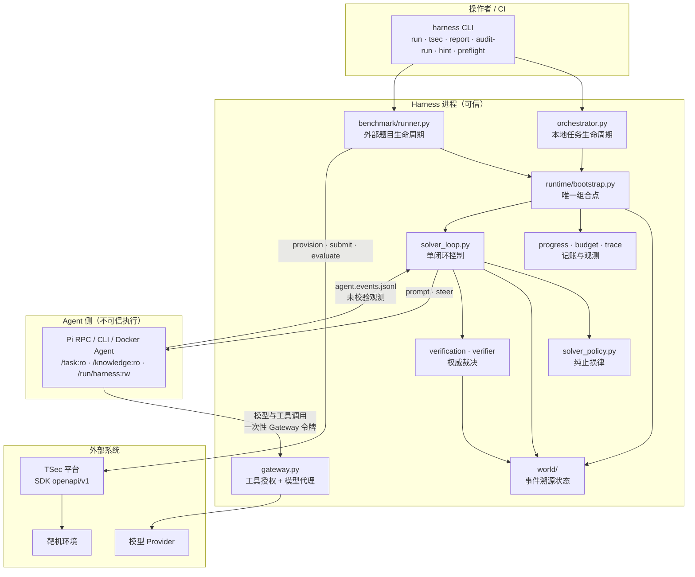
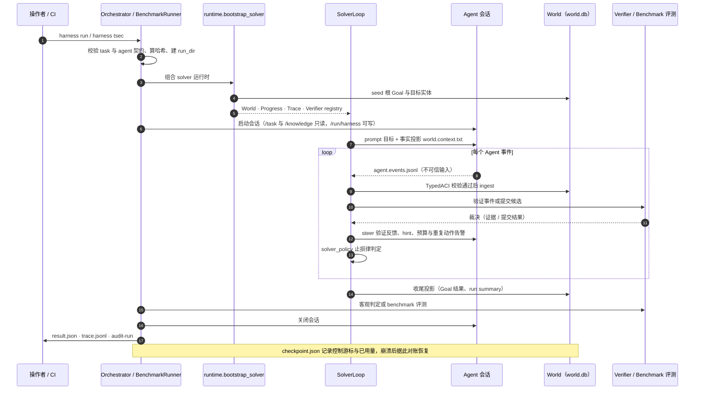
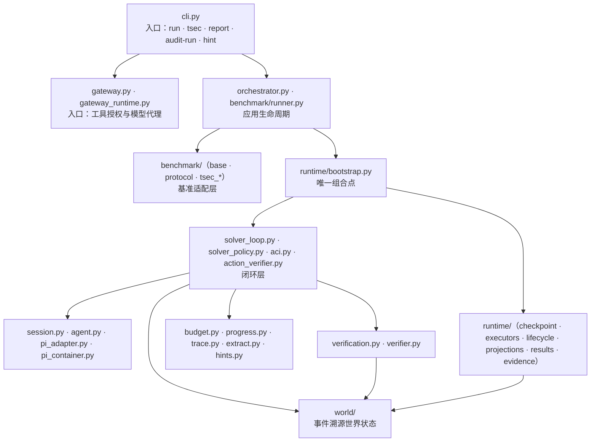
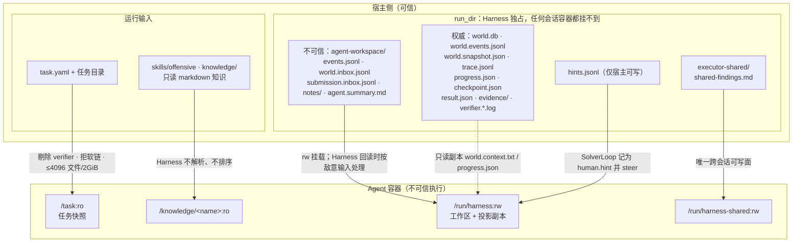
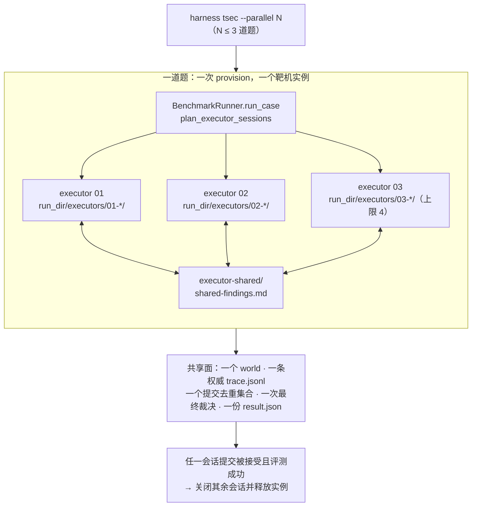

# 架构图：Agent-Native Harness

> 本文把 [agent-architecture-v2.md](agent-architecture-v2.md) 的一页设计落成可核对的结构图。
> 一句话基线：**Harness 供给环境与信任，模型拥有认知。**
> 图中的每个边界都有强制点：`tests/test_architecture.py`（import 方向与冻结的 control spine）、
> `tests/test_executors.py`（会话隔离）、[security/execution-boundary.md](security/execution-boundary.md)
> （容器挂载与信任分层）。
>
> 图源就是下面的 mermaid 代码块（GitHub 直接渲染）。同样五幅图也预渲染成了离线文件，
> 放在 `docs/diagrams/` 下，每个名字都有 `.png` 与 `.svg` 两份，顺序与下文一一对应：
> `01-components`、`02-run-loop`、`03-modules`、`04-trust-boundary`、`05-competition`。
> 改动代码块后重新渲染对应的那一幅即可：
> `npx -y @mermaid-js/mermaid-cli@11.4.2 -i <block>.mmd -o docs/diagrams/<name>.svg -b white`。

## 1. 组件与数据流

要点：

- `runtime.bootstrap_solver` 是本地运行与外部 benchmark 的唯一组合点，两条入口线因此共享
  同一套 World / Progress / Trace / Verifier 装配。
- Agent 只有一条回传通道：写在可写工作区里的 JSONL 观测。它们先过 `TypedACI` 校验，
  再由 Harness 以 `actor=agent` 写入世界，Agent 永远不直接写 `world.db`。
- Gateway 是凭据边界：模型 provider key 留在 Gateway 进程，容器只拿到一次性
  `HARNESS_GATEWAY_TOKEN`。

## 2. 一次运行的闭环时序

止损律是纯函数（`solver_policy.decide_solver_action`）：无进展上限、未确认进展上限、
预算耗尽、低预算且无进展。它只决定 continue / verify / stop，不做规划、不打分、不排序。

## 3. 模块分层与依赖方向

图中只画允许的方向（实线）。反向依赖（`world/ → benchmark|runtime|入口`、
`runtime/ → benchmark|入口`、`benchmark/ → 入口`）连同 `fastapi`/`docker`/`httpx`/`tsec_benchmark`
这类基础设施导入一律禁止：

强制规则（[tests/test_architecture.py](../tests/test_architecture.py)）：

| 规则 | 内容 |
|---|---|
| 方向 | `world/` 不得导入 `benchmark/`、`runtime/`、`orchestrator`、`cli`、`gateway*`；`runtime/` 不得导入 `benchmark/` 与入口模块；`benchmark/` 不得导入入口模块 |
| 基础设施 | `world/` 与 `runtime/` 不得导入 `fastapi`、`starlette`、`docker`、`subprocess`、`httpx`、`tsec_benchmark`；`benchmark/` 不得导入 `fastapi`、`starlette`、`docker` |
| 冻结闭环 | 从 `runtime.bootstrap`、`benchmark.runner`、`solver_loop` 可达的模块必须显式列入 `CONTROL_SPINE`，新模块进闭环要被 reviewer 明确接受 |
| 删除项 | `harness.api`、`control_plane`、`queue`、`worker`、`coordination`、`otel`、`scoring`、`suite`、`evaluation`、`registry`、`cognition`、`planner`、`skills`、`crew`、`runtime.solver_profile` 不得以任何形式复活 |

## 4. 运行目录与信任边界

信任分层（`world.models.TRUST_RANK`）：`claim` < `evidence` < `verified`。
Agent 自述与工具退出码只到 claim；只有授权 verifier 或 benchmark evaluator 能签发
evidence / verified，裁决必须引用 Harness 持久化的证据。

容器可达面之外的东西都是不可协商的：run root、world 存储、result、checkpoint、证据、
verifier 日志与凭据都不进容器。多会话竞争中唯一新增的跨会话可写面是 `executor-shared/`，
只允许放 Agent 自写的 `shared-findings.md`。

## 5. 同题多会话竞争

预算按会话均分（token / 模型调用 / 工具调用 / 成本向下取整，下限 1），
wall_time 不切分，因为并发会话共享同一个赛窗。单个会话触达止损律只关自己；
全部会话结束或预算耗尽才结束该题。

## 6. 图与代码的对应关系

| 图 | 组件 | 代码 | 强制点 |
|---|---|---|---|
| 1 | 唯一组合点 | `src/harness/runtime/bootstrap.py` | `CONTROL_SPINE` 冻结闭包 |
| 1、2 | 单闭环控制 | `src/harness/solver_loop.py` | `tests/test_solver_loop.py` |
| 1、2 | 纯止损律 | `src/harness/solver_policy.py` | `tests/test_control_law_properties.py` |
| 1、2 | 事件校验入口 | `src/harness/aci.py`、`agent_events.py` | `tests/test_solver_loop.py` |
| 1、2 | 预算记账 | `src/harness/budget.py` | `tests/test_budget.py`、`tests/test_control_metrics.py` |
| 1 | 世界状态 | `src/harness/world/` | `tests/test_sqlite_world.py`、`tests/test_world_context.py` |
| 1 | 凭据隔离 | `src/harness/gateway.py`、`gateway_runtime.py` | `tests/test_gateway.py`、[security/gateway-tools.md](security/gateway-tools.md) |
| 2 | 崩溃对账 | `src/harness/runtime/checkpoint.py` | `tests/test_checkpoint.py` |
| 2 | 权威裁决 | `src/harness/verification.py`、`verifier.py` | `tests/test_verification_evidence.py`、`tests/test_verifier.py` |
| 1 | 提示通道 | `src/harness/hints.py` | `tests/test_hint_channel.py` |
| 3 | 依赖方向 | 全包 | `tests/test_architecture.py` |
| 4 | 容器挂载 | `src/harness/agent.py`、`pi_container.py` | [security/execution-boundary.md](security/execution-boundary.md) |
| 5 | 会话隔离与预算切分 | `src/harness/runtime/executors.py`、`benchmark/runner.py` | `tests/test_executors.py` |
